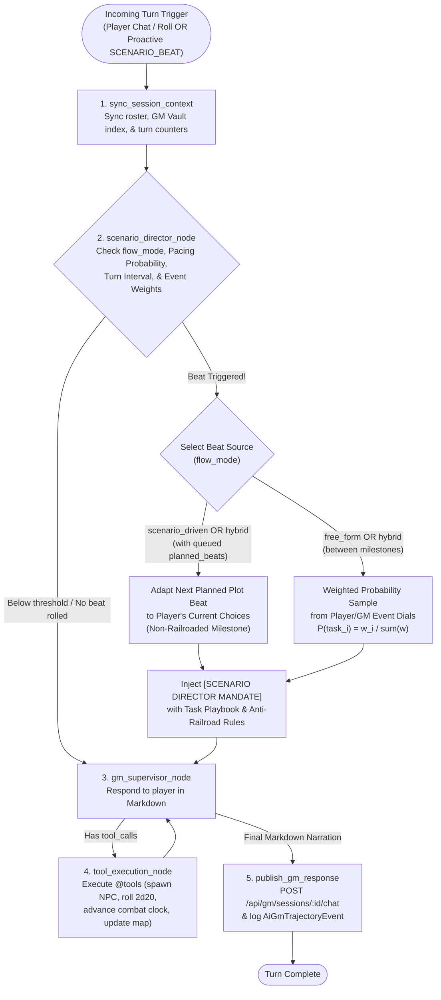

# Implementation Plan: Session Chat Markdown & LangGraph Scenario Director (`implementation.md`)

> [!IMPORTANT]
> This plan covers three coupled deliverables requested for Satya:
> 1. **Markdown Input & Rendering in Session Chat (`satya-web`) + AI GM Markdown Steering (`AGENTS.md` & System Prompts)**
> 2. **Proactive Scenario Director in the LangGraph AI GM (`src/satya_ml/ai_gm/`)** supporting **Scenario-Driven**, **Free-Form**, and **Hybrid** flows, **12 TTRPG event sub-routines**, and **tunable probability dials (`event_weights`)** so players/GMs can dial up what they love (e.g., combat, dramatic scenes) and dial down or disable what they don't (`0%`–`100%`).
> 3. **Architecture Documentation Sync (`docs/technical/ai-gm-agent-design.md`)** updating the design doc to match the Watershed `2d20` roll-over engine, GM Memory Vault, Markdown chat pipeline, and the 5-node Scenario Director LangGraph topology.

---

## Part 1: Markdown Input, Rendering & AI GM Persona Steering

### 1.1 Current State vs. Target Behavior
- **Current State**:
  - [`ActiveSessionWorkspace`](crates/satya-web/src/views_workspace.rs) renders `#chat-input` as a single-line `<input type="text">`.
  - [`format_chat_event_html`](crates/satya-web/src/wasm_client/chat_and_ttrpg.rs) and [`append_system_notice`](crates/satya-web/src/wasm_client/chat_and_ttrpg.rs) escape `ev.body` as plain text (`<div>{}</div>`), so Markdown syntax (`**bold**`, `*italic*`, `` `code` ``, lists, blockquotes, tables, math) is displayed unrendered.
  - Meanwhile, [`satya_engine::render_rules_markdown_to_html`](crates/satya-engine/src/rules_book_html.rs) already implements a zero-dependency, XSS-safe Markdown + LaTeX Math (`$...$`, `$$...$$`) + Mermaid (`flowchart`) HTML renderer with `escape_html_text` on all untrusted text tokens.

### 1.2 Planned Changes (`crates/satya-web` & AI GM Steering)
1. **Multi-Line Markdown Composer (`#chat-input`)**:
   - Upgrade `#chat-input` in [`crates/satya-web/src/views_workspace.rs`](crates/satya-web/src/views_workspace.rs) to a `<textarea id="chat-input" class="chat-markdown-input" rows="2">` with `field-sizing: content` (auto-expanding up to `140px`).
   - Update [`satya_chat_keydown`](crates/satya-web/src/wasm_client/chat_and_ttrpg.rs):
     - `Enter` (without `Shift`) submits the message (`ev.prevent_default(); satya_send_chat();`).
     - `Shift+Enter` inserts a newline so players and GMs can compose multi-line Markdown (lists, blockquotes, code blocks, tables).
     - `ArrowUp` / `ArrowDown` cycles `ChatInputHistory` when the input is single-line, while preserving native vertical cursor navigation inside multi-line drafts.
   - Update [`input_value`](crates/satya-web/src/wasm_client/dom.rs) and [`set_input_value`](crates/satya-web/src/wasm_client/dom.rs) in `wasm_client/dom.rs` to explicitly handle `HtmlTextAreaElement` alongside `HtmlInputElement`.
2. **Safe Markdown Rendering in `#chat-log`**:
   - Add `pub fn format_chat_markdown_html(markdown: &str) -> String` in [`crates/satya-web/src/wasm_client/chat_and_ttrpg.rs`](crates/satya-web/src/wasm_client/chat_and_ttrpg.rs) delegating to [`satya_engine::render_rules_markdown_to_html`](crates/satya-engine/src/rules_book_html.rs) wrapped in `<div class="chat-markdown-body">`.
   - Use `format_chat_markdown_html(&ev.body)` in `format_chat_event_html` and `append_system_notice`.
   - Add compact `.chat-markdown-body` and `.chat-markdown-input` rules in [`crates/satya-web/src/styles.css`](crates/satya-web/src/styles.css) so headings, lists, blockquotes (`> [!WARNING]`, comms intercepts), tables, inline code, and math expressions render cleanly inside `.chat-msg` cards.
3. **AI GM `AGENTS.md`, Persona & System Prompt Steering**:
   - Create [`src/satya_ml/ai_gm/AGENTS.md`](src/satya_ml/ai_gm/AGENTS.md) and link it from root [`AGENTS.md`](AGENTS.md) and [`crates/satya-py/AGENTS.md`](crates/satya-py/AGENTS.md).
   - Update `AUTONOMOUS_SYSTEM_PROMPT` and `CO_PILOT_SYSTEM_PROMPT` in [`src/satya_ml/ai_gm/graph.py`](src/satya_ml/ai_gm/graph.py) and the `@tool` docstrings (`narrate_to_session`, `whisper_to_player`) in [`src/satya_ml/ai_gm/tools.py`](src/satya_ml/ai_gm/tools.py) so the AI GM knows Session Chat renders full Markdown.

---

## Part 2: LangGraph Scenario Director — Hybrid Plot Adaptation + Weighted Probability Dials

### 2.1 How LangGraph Combines Scenario-Driven Plot & Free-Form Probability Knobs

To prevent the AI GM from getting stuck in a passive conversational rabbit hole while never railroading player agency, we introduce a **`scenario_director_node`** between `sync_session_context` and `gm_supervisor_node`:



### 2.2 Three Flow Modes (`flow_mode`) & Anti-Railroading Rules

1. **`"scenario_driven"` (Overarching Plot with Non-Railroaded Adaptation)**:
   - Uses `campaign_premise` and an ordered list of `planned_beats` (key plot events, revelations, or encounters).
   - **Strict Anti-Railroading Mandate**: The AI GM **never invalidates player choices or forces them onto a fixed path**. Instead, when a planned beat triggers, the GM adapts *how* and *where* that plot event manifests so it reacts organically to what the players actually did (e.g., if the players bypassed the embassy to infiltrate the docks, the syndicate envoy or ambush intercepts them at the docks, or the skipped event's consequences ripple forward in the world).
2. **`"free_form"` (Emergent Sandbox Driven by Probability Knobs)**:
   - Driven entirely by the player/GM's **Event Probability Weights (`event_weights: dict[str, float]`)**.
   - Players can dial up the exact mix of experiences they want (e.g., `combat_encounter: 50`, `dramatic_revelation: 30`, `heist_or_infiltration_complication: 20`, `thought_provoking_discussion: 0`). Any event with weight `0` is completely disabled; positive weights are normalized into a probability distribution $P(t_i) = \frac{w_i}{\sum_j w_j}$.
3. **`"hybrid"` (Default — Overarching Plot + Weighted Emergent Beats)**:
   - Mixes both flows: alternates between advancing unplayed `planned_beats` (adapted to player actions without railroading) and sampling emergent world events from the `event_weights` probability dials so the world feels alive and tailored to player tastes even between major story milestones.

### 2.3 Expanded Library of 12 TTRPG Scenario Event Sub-Routines (`SCENARIO_DIRECTOR_TASKS`)

| Task Slug | Category / Pillar | Default Weight | What Happens in the Game World | Suggested Tools |
| :--- | :--- | :---: | :--- | :--- |
| `combat_encounter` | `combat`, `action`, `tactical` | `20.0` | Hostile ambush, breaching charge, security patrol intercept, or sudden crossfire interrupts the scene and demands immediate tactical positioning. | `advance_combat_tracker`, `roll_satya_d20_check`, `generate_tactical_map` / `move_map_token` |
| `mysterious_stranger` | `intrigue`, `mystery`, `espionage` | `15.0` | A covert figure, shadowy observer, or encrypted tight-beam transmission cuts in with a veiled warning, leverage, or clue before slipping away. | `lookup_npc_profile`, `whisper_to_player`, `upsert_gm_memory` |
| `new_npc_arrives` | `social`, `npc`, `intrigue` | `15.0` | A new or recurring NPC physically enters the scene with an urgent agenda, shifting the social dynamic or interrupting a stalled exchange. | `generate_npc_from_description`, `lookup_npc_profile`, `update_npc_state` |
| `dramatic_revelation` | `drama`, `twist`, `emotional` | `15.0` | A sudden plot twist, betrayal, hidden identity reveal, or personal backstory collision raises the emotional and narrative stakes. | `lookup_npc_profile`, `search_gm_memory_and_docs`, `upsert_gm_memory` |
| `thought_provoking_discussion` | `philosophy`, `psyche`, `roleplay` | `10.0` | An NPC confronts the player with a hard philosophical or ethical question testing their 7 bipolar Psyche traits (`EGO`, `SLF`, `OPN`, `BLG`, `EXT`, `CNF`, `AGG`). | `lookup_character_sheet`, `lookup_npc_profile`, `upsert_gm_memory` |
| `discovery_or_clue` | `investigation`, `lore`, `mystery` | `10.0` | A physical clue, forensic trace, encrypted data-slate, or overheard secret surfaces in the environment, opening a fresh investigative lead. | `query_campaign_lore`, `whisper_to_player`, `upsert_gm_memory` |
| `environmental_hazard` | `survival`, `exploration`, `hazard` | `10.0` | The environment turns volatile (depressurization, radiation spike, structural collapse, power failure), requiring immediate Physical/Mental checks. | `roll_satya_d20_check`, `generate_tactical_map`, `narrate_to_session` |
| `ticking_clock_escalation` | `pacing`, `tension`, `urgency` | `10.0` | An off-screen threat or faction countdown visibly advances—reinforcements approach, a transport prepares to undock, or a rival completes a step. | `upsert_gm_memory`, `advance_combat_tracker`, `narrate_to_session` |
| `heist_or_infiltration_complication` | `stealth`, `heist`, `tactical` | `10.0` | A patrol route shifts, a biometric lock cycles, a drone sweeps the room, or a witness nearly spots the crew, demanding fast improvisation. | `roll_satya_d20_check`, `inspect_tactical_map`, `whisper_to_player` |
| `moral_or_faction_dilemma` | `politics`, `factions`, `drama` | `10.0` | Two rival factions or allies make competing, mutually exclusive demands—satisfying one visibly costs standing with the other. | `lookup_npc_profile`, `update_npc_state`, `upsert_gm_memory` |
| `resource_or_gear_windfall` | `loot`, `salvage`, `opportunity` | `5.0` | A time-sensitive opportunity appears—an unguarded cache, prototype equipment, or tactical vantage point—if the crew acts before the window closes. | `roll_satya_d20_check`, `upsert_gm_memory`, `narrate_to_session` |
| `downtime_campfire_moment` | `bonding`, `spotlight`, `roleplay` | `5.0` | A brief quiet beat amidst danger where an ally tends to wounds/fatigue or asks a personal question, giving characters room to breathe and bond. | `lookup_character_sheet`, `update_npc_state`, `narrate_to_session` |

### 2.4 Triggering & Probability Sampling Mechanics
- **Tunable Knobs via `configure_scenario_director` Tool & REST API**:
  - `flow_mode`: `"hybrid"` (default), `"scenario_driven"`, or `"free_form"`.
  - `event_weights`: JSON/dict mapping task slugs (or shorthand pillar names like `"combat"`, `"drama"`, `"intrigue"`, `"thought_provoking_discussion"`) to numeric weights `>= 0.0`. Setting a knob to `0` disables that category; setting `"combat_encounter": 80, "dramatic_revelation": 20` makes 80% of emergent beats combat and 20% high drama.
  - `beat_probability_per_turn`: Float in `0.0..=1.0` (default `0.35`) controlling the chance of an emergent beat firing on any turn before the hard interval cap.
  - `beat_interval_turns`: Hard turn ceiling (default `3` conversational turns) guaranteeing the GM breaks out of prolonged conversational rabbit holes.
- **Two Trigger Paths**:
  1. **In-Graph Automatic Check (`scenario_director_node`)**: Runs on every incoming turn; fires when `turns_since_last_beat >= beat_interval_turns` OR when `turns_since_last_beat >= 1` and the per-turn probability roll (`rng.random() < beat_probability_per_turn`) succeeds.
  2. **Out-of-Band Proactive Beat (`POST /internal/ai-gm/scenario-beat` & `trigger_scenario_beat`)**: Fires immediately even without a player chat prompt, allowing periodic timers or GM UI actions to push a world event to the table.

---

## 3. Files to Create or Modify

| File | Action | Summary of Changes |
| :--- | :--- | :--- |
| [`docs/technical/ai-gm-agent-design.md`](docs/technical/ai-gm-agent-design.md) | Modify | Update architecture doc to reflect the Watershed `2d20` roll-over engine, SQLite GM Memory Vault, Session Chat Markdown pipeline, and the 5-node LangGraph Scenario Director (`scenario_director_node`, 3 flow modes, 12 TTRPG sub-routines, and tunable `event_weights`). |
| [`crates/satya-web/src/views_workspace.rs`](crates/satya-web/src/views_workspace.rs) | Modify | Upgrade `#chat-input` to a multi-line Markdown `<textarea class="chat-markdown-input" rows="2">`. |
| [`crates/satya-web/src/wasm_client/dom.rs`](crates/satya-web/src/wasm_client/dom.rs) | Modify | Support `HtmlTextAreaElement` in `input_value` and `set_input_value`. |
| [`crates/satya-web/src/wasm_client/chat_and_ttrpg.rs`](crates/satya-web/src/wasm_client/chat_and_ttrpg.rs) | Modify | Add `format_chat_markdown_html(markdown)` using `satya_engine::render_rules_markdown_to_html`, wire it into `format_chat_event_html` and `append_system_notice`, and support `Enter` vs. `Shift+Enter` in `satya_chat_keydown`. |
| [`crates/satya-web/src/styles.css`](crates/satya-web/src/styles.css) | Modify | Style `.chat-markdown-input` and `.chat-markdown-body` inside `.chat-msg` bubbles. |
| [`crates/satya-web/src/tests.rs`](crates/satya-web/src/tests.rs) | Modify | Add unit tests verifying Markdown chat rendering (`**bold**`, lists, blockquotes, code, tables, math, XSS escaping). |
| [`src/satya_ml/ai_gm/AGENTS.md`](src/satya_ml/ai_gm/AGENTS.md) & [`AGENTS.md`](AGENTS.md) | Create / Modify | Steering rules for the AI GM covering Markdown output formatting and the Scenario Director node/tools. |
| [`src/satya_ml/ai_gm/tools.py`](src/satya_ml/ai_gm/tools.py) | Modify | Add the 12 `SCENARIO_DIRECTOR_TASKS`, `flow_mode` + weighted probability sampler (`event_weights`), `@tool def configure_scenario_director(...)`, and `@tool def trigger_scenario_beat(...)`, plus Markdown guidance in `narrate_to_session` / `whisper_to_player`. |
| [`src/satya_ml/ai_gm/graph.py`](src/satya_ml/ai_gm/graph.py) | Modify | Update `AUTONOMOUS_SYSTEM_PROMPT` & `CO_PILOT_SYSTEM_PROMPT` for Markdown + Scenario Director awareness; add `scenario_director_node` to `build_ai_gm_graph`. |
| [`src/satya_ml/ai_gm/server.py`](src/satya_ml/ai_gm/server.py) | Modify | Add `ScenarioBeatRequestPayload` (including optional `flow_mode` and `event_weights` overrides) and `POST /internal/ai-gm/scenario-beat`. |
| [`tests/test_satya_ml.py`](tests/test_satya_ml.py) | Modify | Add unit tests for `configure_scenario_director` (including `0%` weight disabling and high-weight combat/drama biasing), `scenario_driven` vs `free_form` vs `hybrid` flows, automatic turn-interval rabbit-hole interruption, and `POST /internal/ai-gm/scenario-beat`. |

---

## 4. Verification Plan

1. **Rust Web & Engine Tests**:
   ```powershell
   cargo test --offline -p satya-web
   cargo clippy --offline -p satya-web --all-targets -- -D warnings
   ```
2. **Python AI GM & LangGraph Tests**:
   ```powershell
   pixi run pytest tests/test_satya_ml.py
   ```
